 

 

## // ABOUT

I'm a Computer Science diploma student from India who loves turning real student problems into simple, accessible and well-structured web apps. I learn by building, I test what I build, and I document honestly what works and what is still in progress.

Next step on my path: a degree course after my diploma, while growing as a UX-focused frontend developer.

| STATUS | DETAIL |
|:---:|:---:|
| Role | CS Diploma Student, Frontend and UX focus |
| Looking for | Internship / entry-level opportunities |
| Certified | ADCA (Advanced Diploma in Computer Applications) |
| Learning now | JavaScript, C, Computer Networks, UX research |

## // TECH STACK

  

## // FEATURED PROJECTS

### SKH Cast+ : Weather Dashboard
Live weather, city search, geolocation, hourly and 7-day forecasts.
- Open-Meteo API with async requests and request cancellation
- Saved unit and theme preferences, responsive layout

**Stack:** HTML, CSS, JavaScript
[Live Demo](https://hansitsingh42-rgb.github.io/Hanshit/skycast/) · [Source](./projects/advanced-weather-app/)

### Student Productivity Dashboard
Tasks, focus timer and study-time tracking in one place.
- Saved state with safe LocalStorage handling
- Input validation and accessible controls

**Stack:** HTML, CSS, JavaScript
[Live Demo](https://hansitsingh42-rgb.github.io/Hanshit/student-productivity-dashboard/) · [Source](./projects/student-productivity-dashboard/)

### Student Study Planner : UX Prototype
A weekly planner designed around visible next actions and distraction-free focus.
- Full UX process: problem, research plan, user flow, wireframe, UI, prototype
- Accessibility and privacy considered

**Stack:** HTML, CSS, JavaScript, Figma
[Live Demo](https://hansitsingh42-rgb.github.io/Hanshit/student-study-planner/) · [Case Study](./docs/ui-ux/student-study-planner-case-study.md)

## // UX CASE STUDY (IN PROGRESS)

**E-commerce Mobile App: UX Foundation**
Problem, users and context, assumptions, research plan, goals, information architecture and core user flow.
[View in Figma](https://www.figma.com/design/Oc854NFgEm0ovihPL5qfY8) · [Read the write-up](./docs/ui-ux/ecommerce-mobile-app-case-study.md)

<b>More Projects</b>

 

| Project | What it is | Status |
|---|---|---|
| [Study Resource Manager](https://hansitsingh42-rgb.github.io/Hanshit/study-resource-manager/) | Search, filter and favorite study material | Deployed |
| [Student Academic Planner](https://hansitsingh42-rgb.github.io/Hanshit/student-academic-planner/) | Subjects, attendance, assignments, notes | Deployed |
| [C Student Record Manager](./projects/c-student-record-manager/) | CRUD with structs and validated input in C | Learning project |
| [Student Resource Hub](https://hansitsingh42-rgb.github.io/Hanshit/student-resource-hub/) | Subject, Chapter, Resource discovery | Active build |
| [Email Campaign Builder](./projects/email-campaign-builder/) | Backend foundation with auth and security work | Work in progress |
| [Jems AI](https://hansitsingh42-rgb.github.io/Hanshit/jems/) | Small assistant answering from documented info | Experimental |

## // 3D CONTRIBUTION VIEW

## // GITHUB ANALYTICS

## // TROPHIES

## // LEARNING JOURNEY

ADCA Certified (done), then CS Diploma (ongoing), then Web Projects (building), then UX Case Studies (in progress), then Degree Course (planned).

## // EXPLORE

## // HOW I WORK

Problem, scope, design, build, test, secure, document, improve.
I keep secrets out of code, validate input, and run CI checks and CodeQL. See [SECURITY.md](./SECURITY.md) and [ENGINEERING.md](./docs/ENGINEERING.md).

## // CONTACT

Open to internships, junior roles and collaboration.

